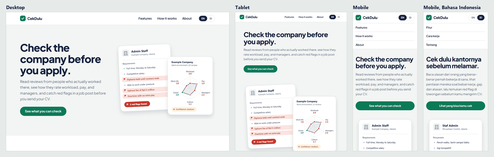

# CekDulu landing page

A responsive landing page for **CekDulu** ("check first" in Indonesian), a concept for a site where workers review their workplaces so job seekers can spot toxic companies before they apply.

Built with **HTML and CSS only, no JavaScript**, as a university assignment on CSS layout and responsive design.

**Live page:** https://garit32.github.io/cekdulu/landing-page-DarrenWangsawidjaja.html



## What's in it

- **Semantic HTML:** `header`, `nav`, `main`, `section`, `article`, `figure`, `footer`.
- **Mobile-first media queries:** mobile up to 767px, tablet 768–1023px, desktop from 1024px. From 1280px the root font size grows with the screen width. Every size is in `rem`, so text, spacing, icons, and the content column scale up together.
- **CSS Grid** for the page layout: the hero, the features (1, then 2, then 3 columns), and the "How it works" timeline. **Flexbox** for the menu, the language switch, and the social links. No floats.
- **English/Indonesian switch without JavaScript:** two hidden radio inputs hold the choice, and `body:has(#lang-id:checked) [lang="en"]` hides the other language. English is the default.
- **Art-directed hero image:** `<picture>` serves a simpler illustration on phones (767px and below), so its text stays readable.
- **Accessibility:** a skip link, visible keyboard focus, a language switch that works with Tab and the arrow keys, and no animation when the system asks for reduced motion.

## Files

```
landing-page-DarrenWangsawidjaja.html   the page
style-DarrenWangsawidjaja.css           all styles (external stylesheet)
images/                                 hero illustrations (EN/ID, desktop/mobile), icons, logo
docs/preview.png                        the screenshot above
```

## Run it

Open `landing-page-DarrenWangsawidjaja.html` in a browser. There is no build step. The font loads from Google Fonts; without a connection, the page falls back to the system font.

## Credits

- Font: [Plus Jakarta Sans](https://github.com/tokotype/PlusJakartaSans) by Tokotype, SIL Open Font License.
- The illustrations and icons were drawn for this project. "Example Company" in the illustration is fictional.
